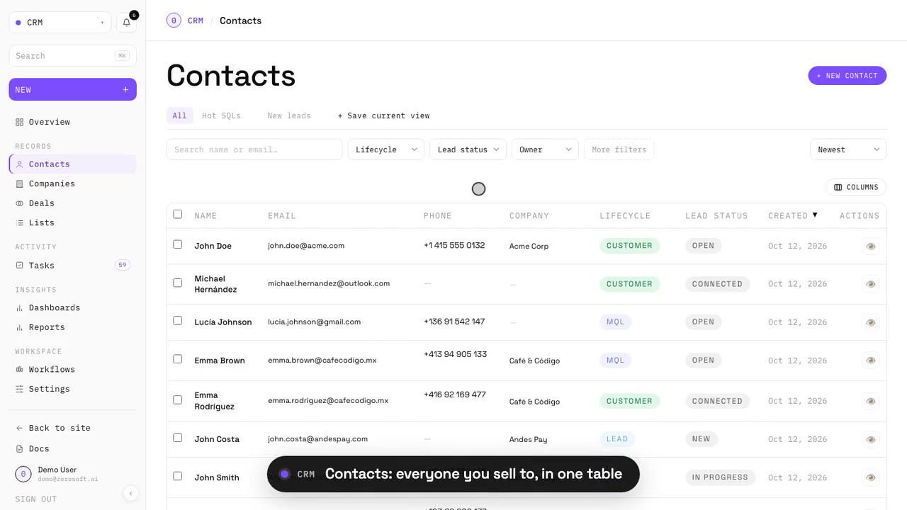
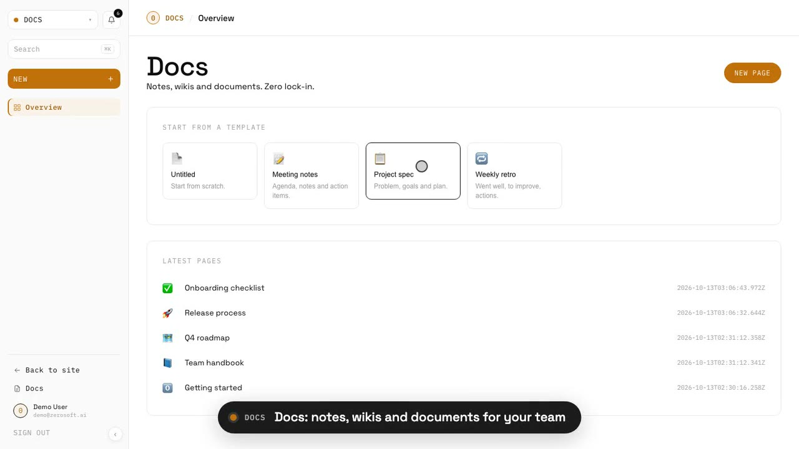

# zerosoft

Open source replacements for the software a company pays for every month: CRM,
issue tracking, docs, scheduling, support chat and 20 more apps in one Next.js
codebase. Self-host it under the AGPLv3, or use it at [zerosoft.ai](https://zerosoft.ai).



## Apps

Each app lives at `/app/<path>` in the same workspace, with one sign-in, one
search (Cmd+K) and one settings page.

**Build**

| App | Replaces | Path |
| --- | --- | --- |
| Track | Linear | `/app/track` |
| Board | Miro | `/app/board` |
| Design | Canva | `/app/design` |
| Pulse | PostHog | `/app/pulse` |

**Sell**

| App | Replaces | Path |
| --- | --- | --- |
| CRM | HubSpot | `/app/crm` |
| Link | Bitly | `/app/links` |
| Shop | Shopify, Tiendanube | `/app/shop` |
| Social | Hootsuite | `/app/social` |
| Forms | Typeform | `/app/forms` |
| Send | DocSend | `/app/send` |

**Support**

| App | Replaces | Path |
| --- | --- | --- |
| Chat | Intercom | `/app/chat` |
| Groups | Periskope (WhatsApp groups) | `/app/groups` |

**Automate**

| App | Replaces | Path |
| --- | --- | --- |
| Agents | Intercom Fin | `/app/agents` |
| Flow | Zapier, n8n | `/app/flow` |
| Robots | UiPath | `/app/robots` |

**Run**

| App | Replaces | Path |
| --- | --- | --- |
| Hiring | Workable | `/app/hiring` |
| People | BambooHR | `/app/people` |
| Books | Xero, QuickBooks | `/app/books` |
| Sign | DocuSign | `/app/sign` |

**Daily work**

| App | Replaces | Path |
| --- | --- | --- |
| Docs | Notion | `/app/docs` |
| Notes | Evernote | `/app/notes` |
| Cal | Calendly | `/app/calendar` |
| Voice | Wispr Flow, Granola | `/app/voice` |
| Rec | Loom | `/app/rec` |
| Talk | Slack | `/app/talk` |

The repository also holds the marketing site and blog (in English, Spanish and
Portuguese), the public REST API (`/api/v1`, documented at `/docs`), an MCP
server, a desktop app (`desktop/`), a mobile shell (`mobile/`), a CLI (`cli/`)
and a Chrome extension (`extensions/chrome`).



## Quickstart

You need Node.js 22 or later. No accounts or API keys: the offline config runs
every app against local fakes.

```bash
git clone https://github.com/lschiaffino/zerosoft && cd zerosoft
npm install
cp .env.offline.example .env.local
npm run seed        # demo user, plus sample data for Link and CRM
npm run dev         # http://localhost:3000/en/app
```

With `DEMO_MODE=true` you are signed in as the demo user. The other apps
start with little or no data. Everything lives in a
local SQLite file at `data/zerosoftware.db`; delete it and run `npm run seed`
again to start over.

## Self-hosting

`docker compose up -d` runs the production build with your data in two Docker
volumes. Environment variables, reverse proxy setup, crons and bringing your
own AI and WhatsApp providers are covered in
[docs/self-hosting.md](docs/self-hosting.md).

## Stack

Next.js 15 (App Router), React 19, TypeScript, libSQL (a local SQLite file or
Turso), next-intl, next-auth, plain CSS with design tokens. Vitest for unit
tests, Playwright for end-to-end tests.

## Contributing

Bug fixes, missing features from the tools we replace, and translations are
welcome. Read [CONTRIBUTING.md](CONTRIBUTING.md) first: it covers the
architecture, offline development, the checks, and the one-click
[CLA](CLA.md). If you use a coding agent, point it at [AGENTS.md](AGENTS.md).
AI-assisted pull requests follow [AI_POLICY.md](AI_POLICY.md).

Security issues: [SECURITY.md](SECURITY.md). Conduct: [CODE_OF_CONDUCT.md](CODE_OF_CONDUCT.md).

## License

- Everything outside `ee/`, which is every feature of every app, is [AGPLv3](LICENSE).
- `ee/` holds only enterprise features (SSO/SAML, SCIM, audit export, custom roles, white-label, multi-workspace admin) under the source-available [Zerosoft Enterprise License](ee/LICENSE): free for development, a subscription for production. See [ee/README.md](ee/README.md).
- The zerosoft name and logo are not covered by either license. See [TRADEMARK.md](TRADEMARK.md).
